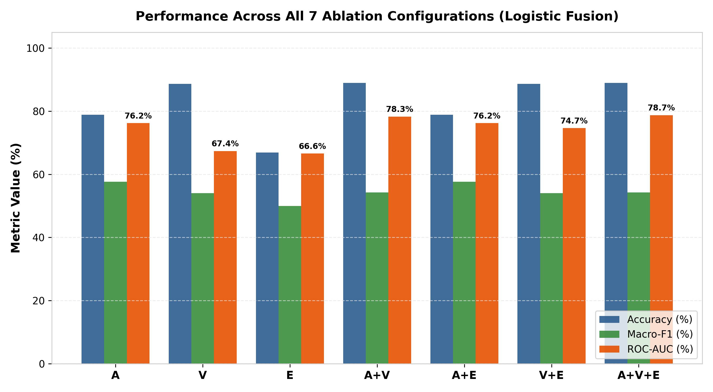
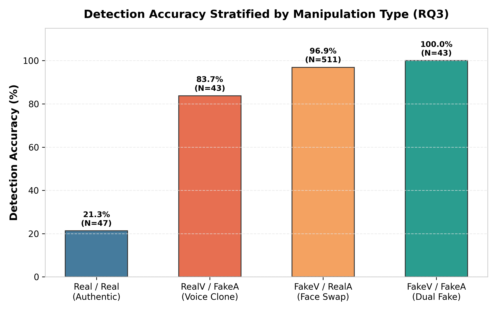
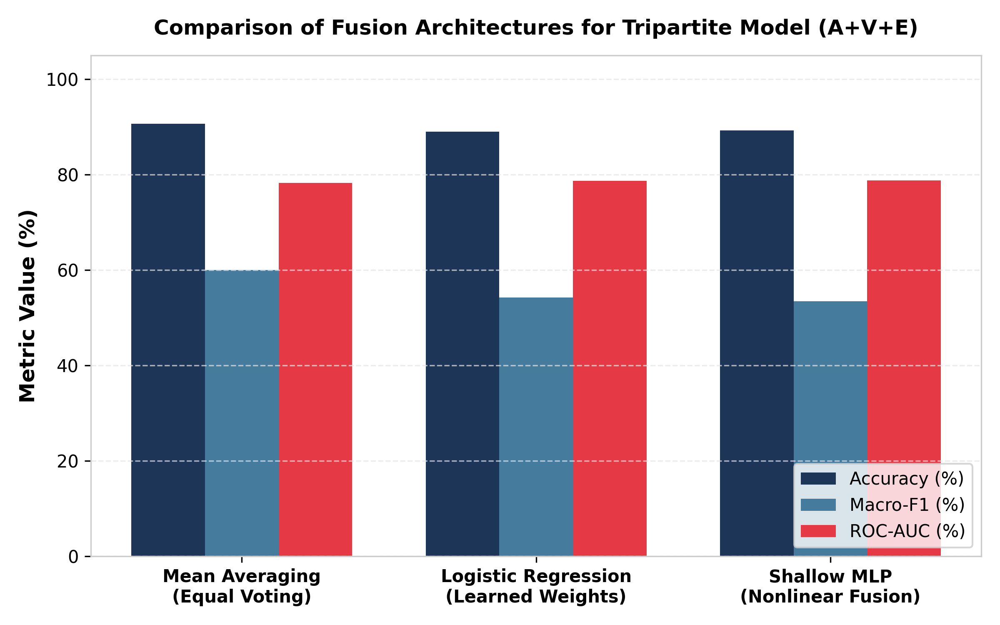
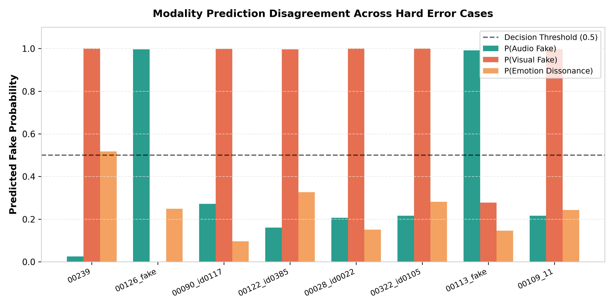

# Multimodal Deepfake Detection: Audio, Visual, and Emotion-Consistency Evidence

[](https://www.python.org/)
[](https://pytorch.org/)
[](https://developers.google.com/mediapipe)
[-orange.svg)](https://huggingface.co/datasets/advy/fakeavceleb-detect)

An end-to-end multimodal deepfake detection framework that integrates **acoustic forensics**, **visual artifact detection**, and **cross-modal emotion consistency** to identify speaking-person manipulations across voice cloning, face swaps, and dual deepfakes.

Evaluated on a balanced benchmark subset of the **FakeAVCeleb dataset** ($N = 2{,}144$ video clips; $N_{\text{test}} = 644$ stratified held-out clips) across **7 ablation configurations**, **3 fusion architectures**, and **4 manipulation categories**.

---

## 📌 Architecture Overview

```
                          ┌────────────────────────┐
                          │ Video Stream (Frames)  │
                          └───────────┬────────────┘
                                      │
            ┌─────────────────────────┴─────────────────────────┐
            ▼                                                   ▼
┌────────────────────────┐                             ┌────────────────────────┐
│  EfficientNet-B0 CNN   │                             │ MediaPipe 3D Mesh & AU │
│ (1280-d Visual Embed)  │                             │  52 Facial Blendshapes │
└───────────┬────────────┘                             └───────────┬────────────┘
            ▼                                                      │
   Visual Forensic P(V)                                            │
                                                                   ▼
                                                       ┌────────────────────────┐
                                                       │   Emotion Divergence   │
                                                       │  (SKL, JS, L1, Cosine) │
                                                       └───────────┬────────────┘
            ▲                                                      │
   Audio Forensic P(A)                                             ▼
            │                                             Emotion Forensic P(E)
┌───────────┴────────────┐                                         │
│ 2D CNN Spectrogram Enc │                                         │
│  (3 x 40 x 301 MFCCs)  │                                         │
└───────────▲────────────┘                                         │
            │                                                      │
 ┌──────────┴────────────┐                                         │
 │ Audio Stream (Speech) │                                         │
 └───────────────────────┘                                         │
                                                                   │
            ┌──────────────────────────────────────────────────────┘
            ▼
┌────────────────────────────────────────────────────────────────────────┐
│                      Multimodal Fusion Classifiers                     │
│        (1) Mean Averaging  •  (2) Logistic Regression  •  (3) MLP      │
└───────────────────────────────────┬────────────────────────────────────┘
                                    ▼
                         Final Prediction: Real / Fake
```

---

## 🔬 Key Empirical Findings

### 1. Table 1: 7-Configuration Ablation Study (Logistic Fusion, Held-Out $N_{\text{test}} = 644$)

| Configuration | Modalities | Accuracy | Macro-F1 | ROC-AUC | Precision | Recall | Core Takeaway |
|:---|:---:|:---:|:---:|:---:|:---:|:---|
| **A** | Audio | 0.7888 | 0.5765 | 0.7624 | 0.5713 | 0.6803 | Strong speech forensic baseline; blind to silent face swaps |
| **V** | Visual | 0.8866 | 0.5402 | 0.6738 | 0.5451 | 0.5370 | High accuracy on face swaps; modest ROC-AUC |
| **E** | Emotion Divergence | 0.6693 | 0.4996 | 0.6660 | 0.5406 | 0.6354 | Standalone affective anomaly detector |
| **A+V** | Audio + Visual | 0.8898 | 0.5428 | 0.7829 | 0.5496 | 0.5387 | Standard bimodal baseline (+10.9% AUC over V alone) |
| **A+E** | Audio + Emotion | 0.7888 | 0.5765 | 0.7621 | 0.5713 | 0.6803 | Audio-anchored affective consistency |
| **V+E** | Visual + Emotion | 0.8866 | 0.5402 | 0.7466 | 0.5451 | 0.5370 | **+7.28% AUC jump** over visual alone ($0.6738 \to 0.7466$) |
| **A+V+E** | **Full Tripartite** | **0.8898** | **0.5428** | **0.7874** | **0.5496** | **0.5387** | **Highest overall ROC-AUC (0.7874)** |

### 2. Table 2: Fusion Strategy Comparison ($A+V+E$ Tripartite Model)

| Fusion Strategy | Accuracy | Macro-F1 | ROC-AUC | Learned Weights / Architecture |
|:---|:---:|:---:|:---:|:---|
| **Mean Averaging** | **0.9068** | **0.6002** | 0.7829 | Equal democratic voting ($P = \frac{1}{3}(P_A + P_V + P_E)$) |
| **Logistic Regression** | 0.8898 | 0.5428 | 0.7874 | $w_V = 8.32, w_A = 2.58, w_E = 0.36$ |
| **Shallow MLP** | 0.8929 | 0.5348 | **0.7879** | 16-dim hidden layer + ReLU + Dropout (0.2) |

> **Takeaway:** Democratic Mean Averaging achieves the highest Macro-F1 (**0.6002**) and raw Accuracy (**90.68%**), while Logistic Regression and MLP optimize probability ranking and ROC-AUC (**0.7874 – 0.7879**).

### 3. Table 3: Manipulation-Type Stratification (RQ3)

| Manipulation Category | Description | Test Clips ($N$) | Detection Recall | Operational Behavior |
|:---|:---|:---:|:---:|:---|
| **FakeVideo-FakeAudio** | Dual Deepfake | 43 | **100.00%** | Both streams corrupted; all branches agree |
| **FakeVideo-RealAudio** | Face Swap | 511 | **96.87%** | Visual boundary artifacts flagged |
| **RealVideo-FakeAudio** | Voice Clone | 43 | **83.72%** | Audio synthesis artifacts detected; visual camouflaged |
| **RealVideo-RealAudio** | Authentic Speech/Video | 47 | **21.28%** | Web JPEG compression noise triggers visual false alarms |

---

## 📊 Visualizations

| Figure 1: 7 Ablation Configurations | Figure 2: Manipulation Stratification |
|:---:|:---:|
|  |  |

| Figure 3: Fusion Comparison | Figure 4: Hard Error Audit & Disagreement |
|:---:|:---:|
|  |  |

---

## 📁 Repository Structure

```
nlp_deepfake/
├── configs/
│   └── config.py               # Central hyperparameters, device, ablation mappings
├── data/
│   ├── fakeavceleb_metadata.csv # Subset metadata & labels
│   └── splits/                 # Data split manifests
├── models/
│   ├── face_landmarker.task    # Google MediaPipe 3D landmarker task bundle
│   └── detector.tflite         # Auxiliary face detector
├── outputs/
│   ├── figures/                # High-res publication plots (300 DPI)
│   ├── results/
│   │   └── final_experimental_results.json # Full benchmark metric logs
│   └── scores/
│       └── extracted_features.pt # Cached multimodal feature tensors (N=2,144)
├── src/
│   ├── extract_features.py     # Scale MediaPipe & CNN feature extraction pipeline
│   ├── train_and_evaluate.py   # 7 ablations, 3 fusions, temporal pooling & error audit
│   ├── generate_visualizations.py # Matplotlib publication plot generator
│   ├── inspect_results.py      # Quick evaluation terminal inspector
│   ├── branches/               # Modular audio, visual, and emotion branches
│   └── fusion/                 # Mean, Logistic, and MLP fusion models
├── run_pipeline.ps1            # One-click execution script (PowerShell)
├── run_pipeline.bat            # One-click execution script (Batch)
├── requirements.txt            # Python dependencies
├── .gitignore                  # Git tracking rules
└── README.md                   # Project documentation
```

---

## 🚀 Quickstart & Reproducibility

### 1. Environment Setup

```bash
# Clone the repository
git clone https://github.com/SatvickMiglani/nlp_deepfake.git
cd nlp_deepfake

# Create and activate virtual environment
python -m venv venv
venv\Scripts\activate      # Windows
# source venv/bin/activate  # Linux/macOS

# Install dependencies
pip install -r requirements.txt
```

### 2. Run Evaluation on Cached Features

The pre-extracted features for all $2{,}144$ clips are cached in `outputs/scores/extracted_features.pt`. You can replicate the entire evaluation without re-extracting:

```bash
python src/train_and_evaluate.py
```

### 3. Generate Visualizations

To reproduce all 4 publication figures:

```bash
python src/generate_visualizations.py
```

### 4. (Optional) Re-extract from Hugging Face Shards

To run full end-to-end feature extraction from raw shards:

```powershell
.\run_pipeline.ps1 -TargetClips 2144
```

---

## 👥 Authors & Academic Context

- **Course:** CSET 346 — Natural Language Processing
- **Institution:** School of Computer Science Engineering and Technology, Bennett University
- **Student Contributors:**
  - Satvick Miglani
  - Shreya Ghosh
  - Prithivi Alamyan
  - Sanyam Singla
  - Ananya Bakshi
- **Faculty Mentor:** Dr. Sakshi

---

## 📄 License & Attribution

This project is released for academic research and educational evaluation. The dataset is sourced from the [FakeAVCeleb Benchmark](https://github.com/DASH-Lab/FakeAVCeleb) via Hugging Face Hub (`advy/fakeavceleb-detect`).
